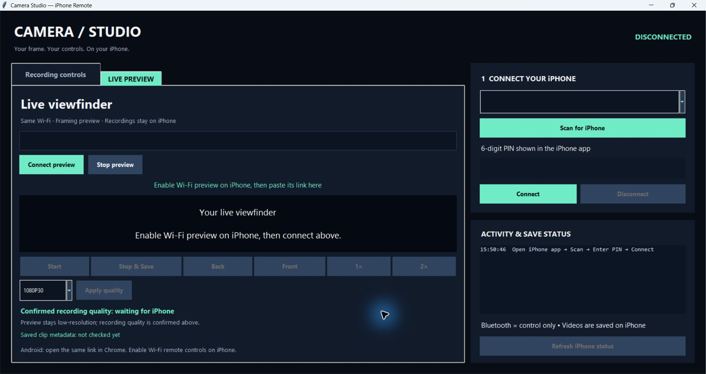
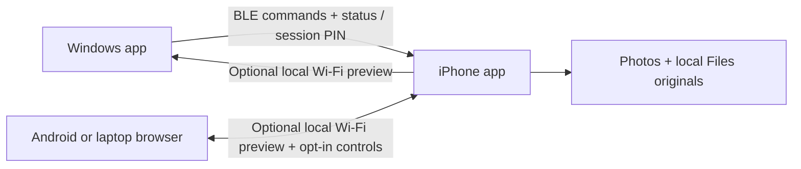

<p align="center"></p>

<p align="center">
  <a href="https://github.com/msaadatmustafa-tech/ShutterBridge/releases/latest"></a>
  <a href="https://github.com/msaadatmustafa-tech/ShutterBridge/actions/workflows/build-ios-ipa.yml"></a>
  <a href="LICENSE"></a>
</p>

# ShutterBridge

**Control your iPhone camera from Windows or an Android browser. Record locally in up to 4K60. No Mac required for the Windows installation route.**

A local-first, open-source **SayCheese alternative** for creators who want a remote viewfinder and camera controls while their iPhone does the recording. Independent project; not affiliated with SayCheese or Apple.

<p align="center">
  <a href="https://github.com/msaadatmustafa-tech/ShutterBridge/releases/download/v1.5.0/ShutterBridge-Windows-v1.5.exe"></a>
  <a href="https://github.com/msaadatmustafa-tech/ShutterBridge/releases/download/v1.5.0/ShutterBridge-iPhone-v1.5-unsigned.ipa"></a>
  <a href="https://github.com/msaadatmustafa-tech/ShutterBridge/archive/refs/heads/main.zip"></a>
</p>

> **First time here?** For Windows control, download **both** the EXE and iPhone IPA. The IPA is **unsigned**: sign/install it with your own Apple ID using Sideloadly on Windows. Initial installation requires a USB data cable. Android uses the browser remote and needs **no APK**.

[**A-to-Z English setup**](docs/GETTING_STARTED.md) · [Roman Urdu setup](WINDOWS_IPHONE_SETUP_ROMAN_URDU.md) · [Troubleshooting & FAQ](docs/GETTING_STARTED.md#troubleshooting) · [Verified tests](VERIFICATION_AND_INSTALL.md) · [Release notes](https://github.com/msaadatmustafa-tech/ShutterBridge/releases/latest)

## Downloads

| Package | Download | What it does |
|---|---|---|
| **Windows controller** | [Download EXE](https://github.com/msaadatmustafa-tech/ShutterBridge/releases/download/v1.5.0/ShutterBridge-Windows-v1.5.exe) | Desktop controls and optional viewfinder. No Python required for this binary. |
| **iPhone companion** | [Download unsigned IPA](https://github.com/msaadatmustafa-tech/ShutterBridge/releases/download/v1.5.0/ShutterBridge-iPhone-v1.5-unsigned.ipa) | Native recording app, v1.5 / build 8. Personal signing required. |
| **Latest source + guides** | [Download main ZIP](https://github.com/msaadatmustafa-tech/ShutterBridge/archive/refs/heads/main.zip) | Current source, Xcode project, English/Roman Urdu guides and workflows. |
| **Versioned release source** | [Download v1.5.0 ZIP](https://github.com/msaadatmustafa-tech/ShutterBridge/releases/download/v1.5.0/ShutterBridge-v1.5.0-source.zip) | Fixed source snapshot used for the release; later documentation updates live on main. |
| **Release checksums** | [SHA256SUMS.txt](https://github.com/msaadatmustafa-tech/ShutterBridge/releases/download/v1.5.0/SHA256SUMS.txt) | Verify the versioned EXE, IPA and release source ZIP. |

The EXE and IPA are unsigned downloads. Opening the IPA directly on iPhone will not install it. Follow the [complete installation guide](docs/GETTING_STARTED.md#install-the-iphone-app-from-windows). No Apple password, certificate or provisioning profile is included.

<details>
<summary><strong>Contents — setup, controls, recordings and development</strong></summary>

- [What you get](#what-you-get)
- [Windows interface](#windows-interface)
- [How it connects](#how-it-connects)
- [Quick start](#quick-start)
- [Complete installation and permissions](docs/GETTING_STARTED.md)
- [Controls and quality selection](docs/GETTING_STARTED.md#controls-and-recording-quality)
- [Photos, Files and export](docs/GETTING_STARTED.md#find-and-export-recordings)
- [Troubleshooting and FAQ](docs/GETTING_STARTED.md#troubleshooting)
- [Actual verification](#what-has-actually-been-verified)
- [Requirements and limits](#requirements-and-limits)
- [Build and contribute](#build-and-contribute)
- [Privacy and security](#privacy-and-security)

</details>

If ShutterBridge helps your next shoot, **give the repository a ⭐**. Stars help other Windows + iPhone creators find it. Built by [@msaadatmustafa-tech](https://github.com/msaadatmustafa-tech).

## What you get

- **Windows remote:** Bluetooth LE start/stop, camera switching, zoom and quality controls, with an optional live Wi-Fi viewfinder.
- **iPhone camera app:** full-screen recording view, timer, visible permissions and selectable supported formats.
- **Android remote:** scan the iPhone QR code and use Chrome; no Android APK required. The same browser remote also works on a laptop.
- **4K / 1080p / 720p at 30 or 60 FPS:** options come from the selected camera's real capabilities. Confirmed dimensions/FPS are shown separately from the pending selection.
- **Local originals + Photos:** recordings stay on iPhone; the app saves to Photos when permitted and keeps a Files backup.
- **No app-imposed duration limit:** available storage, power, temperature and iOS interruptions still limit recording.
- **No Mac ownership required:** download the unsigned iPhone app or compile it using GitHub Actions, then sign/install locally from Windows.

## Windows interface



*Windows Camera Studio dashboard during v1.5 development, shown before connecting. No personal footage, session PIN or access link is shown. The installed iPhone companion appears as “iPhone BLE Camera”.*

## How it connects



Bluetooth carries commands/status, never video. Wi-Fi preview is a silent **up-to-640px, up-to-5-FPS framing feed**. Your saved movie uses the confirmed recording quality independently.

## Quick start

### 1. Install the iPhone companion

1. Download `ShutterBridge-iPhone-v1.5-unsigned.ipa` from [Releases](https://github.com/msaadatmustafa-tech/ShutterBridge/releases/latest).
2. Install [Sideloadly](https://sideloadly.io/) on Windows, following its official driver/dependency instructions.
3. Connect and unlock iPhone by USB, accept **Trust This Computer**, and select the IPA in Sideloadly.
4. Sign/install using **your own Apple ID locally**. Complete any trust / Developer Mode prompts on iPhone. The download is unsigned and cannot run until personally signed.
5. Open **iPhone BLE Camera**. Grant Camera and Bluetooth permissions; Microphone enables sound and Add Photos enables gallery saving. Keep the app open and iPhone unlocked.

Signing may expire and require refresh; see the [official Sideloadly FAQ](https://sideloadly.io/faq). Keep the same Apple ID/bundle ID when updating and back up clips first. Never put Apple passwords, signing certificates or provisioning profiles in GitHub.

The installed app currently uses the **Camera Studio** interface and **iPhone BLE Camera** display name. ShutterBridge is the public project name.

### 2. Connect Windows

1. Download `ShutterBridge-Windows-v1.5.exe` from [Releases](https://github.com/msaadatmustafa-tech/ShutterBridge/releases/latest), or run `Windows/START_WINDOWS.bat` from source with Python 3.11+ and Tkinter installed.
2. Turn on Bluetooth on both devices. In the Windows app choose **Scan for iPhone**, select `iPhoneCam`, enter the six-digit PIN shown in the iPhone app, and **Connect**. OS Bluetooth pairing is not the app's connection flow.
3. While stopped, select a supported quality and click **Apply quality**. Check the **Confirmed on iPhone** dimensions/FPS.
4. Press **Start**, then **Stop & Save**. Wait for the saved-file / Photos result.

The EXE is unsigned. Source and build steps are provided so you can inspect and build your own copy.

### 3. Add live view / Android remote

1. Put the devices on the same trusted Wi-Fi.
2. On iPhone tap **Enable Wi-Fi preview** and allow Local Network access.
3. Windows: paste the complete iPhone link into **LIVE PREVIEW → Connect preview**. Native desktop buttons use your Bluetooth connection.
4. Android: enable **Allow Wi-Fi remote controls** on iPhone, then scan its QR code with Camera / Google Lens and open the page in Chrome.
5. Keep iPhone foreground/unlocked. Stop recording before applying another quality or camera. Zoom can be adjusted during recording.

See the [Wi-Fi guide](WIFI_ANDROID_SETUP.md) for reconnection, privacy and troubleshooting.

## What has actually been verified?

On **4 November 2026**, using one Windows laptop and one physical iPhone:

| Check | Observed result |
|---|---|
| Front and back recording | All 12 combinations: 4K/1080p/720p × 30/60 FPS × 2 cameras |
| Saved movie metadata | Expected dimensions and 30 or approximately 60 FPS; nominal-60 clips measured 59.95–60.00 FPS |
| Photos saving | Success reported for test clips; owner confirmed recordings appear in Gallery |
| Windows EXE | Built/launched; real BLE discovery, PIN auth, quality apply, Start and Stop & Save verified |
| Desktop recording | About 25 seconds at 3840×2160 @ 59.95 FPS; Photos success received |
| Browser remote | Real iPhone-hosted page tested in Windows Chrome: quality apply, front/back, 1×/2×, start/stop and saved 4K30 metadata |
| Android | Owner confirmed the remote connected; latest browser logic tested against real iPhone in Windows Chrome, not fully re-tested on physical Android |
| Automated tests | 19 Windows tests passed; dependency check passed |
| iOS | GitHub Actions Xcode build succeeded; v1.5/build 8 IPA integrity checked and installed with Sideloadly |

This is a tested personal project, not broad device certification. Gallery playback/audio quality, extended capture, thermal/battery behavior, low storage and interruption recovery still need wider testing. See [detailed evidence and remaining checks](VERIFICATION_AND_INSTALL.md).

## Requirements and limits

- Windows laptop with Bluetooth LE; developed/tested on Windows 11. Other Windows configurations need testing.
- iPhone with iOS 16+ and sufficient storage. Available formats depend on that specific camera/device.
- Same trusted Wi-Fi for preview/browser control; local guest-network isolation or VPNs can prevent connection.
- Initial USB connection and personal signing for Windows sideloading. No jailbreak needed.
- This controls the installed companion app, not Apple's built-in Camera app.
- Foreground operation only. Locking/backgrounding stops capture; return to the app to resume the preview session.
- There is no 4K stream or file transfer over Bluetooth, cloud recording service, background capture mode or App Store installation in this release.

## Build and contribute

```powershell
# Windows, from the repository root (after START_WINDOWS.bat creates .venv)
.\Windows\.venv\Scripts\python.exe -m unittest discover -s Windows -v
.\Windows\.venv\Scripts\python.exe -m pip check
```

- **Windows EXE:** run `Windows/BUILD_EXE.bat`; output is `Windows/dist/iPhoneCameraRemote.exe`.
- **iPhone IPA, no Mac of your own:** fork this repository, enable Actions, run **Build iPhone IPA (no Mac required)** and download the `iPhoneBLECamera-unsigned-IPA` artifact. Sign it locally.
- **Mac:** open `iPhone/iPhoneBLECamera.xcodeproj` in Xcode and choose your own signing team/bundle ID.

[Contributing guide](CONTRIBUTING.md) · [BLE / Wi-Fi protocol](PROTOCOL.md) · [Changelog](CHANGELOG.md) · [Security](SECURITY.md)

## Privacy and security

Capture and playback permissions are visible. There is no camera-control account, backend or analytics. Windows installation/build and GitHub downloads require internet; camera use stays local.

The BLE PIN is an application access gate, not a claim of encrypted Bluetooth pairing. Wi-Fi uses unencrypted local HTTP with a random link key; anyone on the same network with that link can view preview, and can control it when Wi-Fi remote controls are enabled. Use a trusted network, keep links/PINs private, never forward the port to the internet, and turn Wi-Fi preview off to revoke the link. Backgrounding pauses the listener; returning to foreground resumes the same session key/port. Explicit Off revokes the session.

## License

[MIT](LICENSE). Contributions and practical device reports are welcome. Please remove private links, PINs, account details and personal footage before sharing logs or screenshots.
